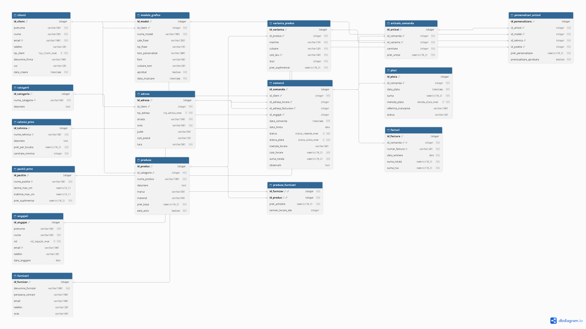

# Mindfit București - bază de date PostgreSQL

Acesta este un proiect personal în care am făcut o bază de date pentru un magazin care personalizează tricouri și alte haine (Mindfit București). Am vrut să exersez SQL pe un exemplu cât mai apropiat de o situație reală: clientul alege un produs, apoi alege și ce vrea să fie imprimat pe el.

## Ce conține proiectul

- schema bazei de date (16 tabele)
- date de test, inventate de mine
- interogări SQL de exemplu
- diagrama bazei de date

## Instrumente folosite

- PostgreSQL
- pgAdmin (pentru a rula scripturile)
- dbdiagram.io (pentru diagramă)
- Git și GitHub

## Cum am gândit baza de date

Un magazin obișnuit are produse și comenzi. La Mindfit comanda are în plus personalizări, așa că am avut nevoie de tabele separate pentru ele. Un articol din comandă poate avea mai multe personalizări (de exemplu un logo pe piept și un nume pe spate), fiecare cu tehnica ei de print și poziția ei.

Tabelele principale:

- `clienti` și `adrese` - datele clienților (persoane fizice sau firme) și adresele de livrare/facturare
- `categorii`, `produse`, `variante_produs` - produsele, cu variantele pe mărime și culoare
- `tehnici_print`, `pozitii_print`, `modele_grafice` - tot ce ține de personalizare
- `comenzi`, `articole_comanda`, `personalizari_articol` - comenzile și ce conțin ele
- `plati`, `facturi` - plățile și facturile
- `angajati`, `furnizori`, `produse_furnizori` - angajații și furnizorii

Relația `produse_furnizori` este de tip mulți-la-mulți (un furnizor vinde mai multe produse, iar un produs poate veni de la mai mulți furnizori).

## Diagrama

## Cum se rulează

1. Creez o bază de date nouă, numită `mindfit`.
2. Rulez `sql/01_schema.sql` (creează tabelele).
3. Rulez `sql/02_data.sql` (adaugă datele de test).
4. Rulez interogările din `sql/03_queries.sql`.

Scripturile trebuie rulate în această ordine, altfel apar erori la cheile străine.

## Exemple de interogări

În `03_queries.sql` am scris 15 interogări. Câteva dintre ele:

- cât a cheltuit fiecare client, în ordine descrescătoare (`JOIN`, `GROUP BY`, `ORDER BY ... DESC`)
- valoarea stocului pe categorie
- venitul pe fiecare lună
- comenzile care nu sunt plătite complet (`LEFT JOIN`, `HAVING`)
- un `VIEW` care arată detaliile unei comenzi (client, produse, personalizări)

## Ce am învățat

- cum să împart informația în mai multe tabele și să le leg prin chei primare și chei străine
- diferența dintre `INNER JOIN` și `LEFT JOIN`
- cum funcționează `GROUP BY` cu `HAVING`
- cum se scrie un `VIEW`

## Ce aș vrea să adaug mai departe

- indexuri, ca interogările să fie mai rapide
- trigger care să scadă automat stocul când se face o comandă
- o aplicație simplă care să se conecteze la baza de date

## Observație

Toate datele din proiect sunt inventate (nume, emailuri, telefoane, CUI) și nu aparțin unor persoane sau firme reale.
